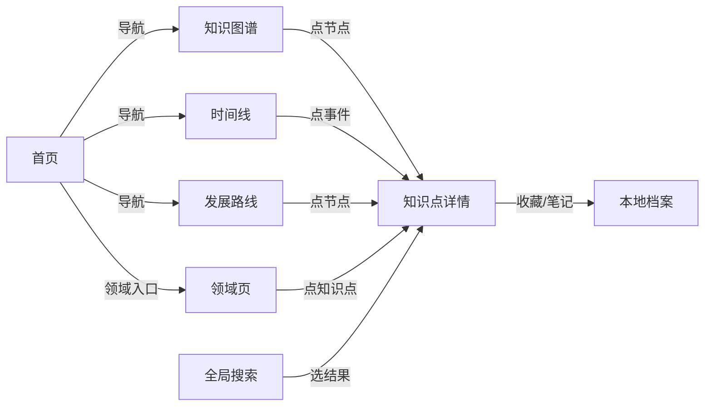
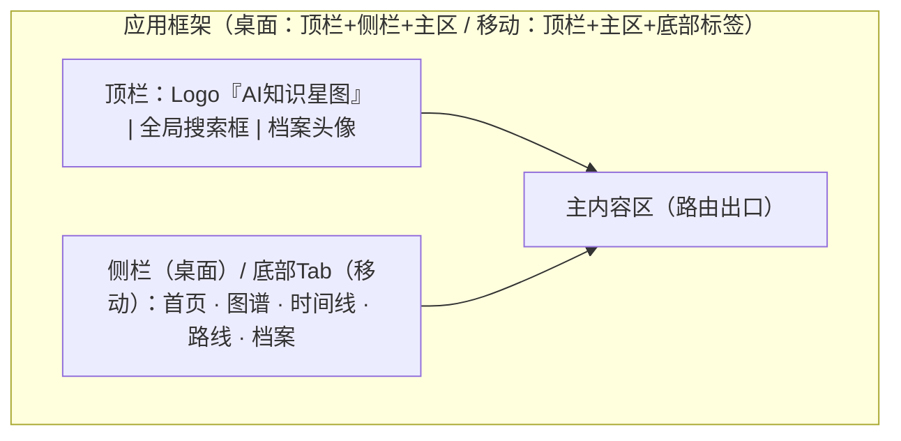
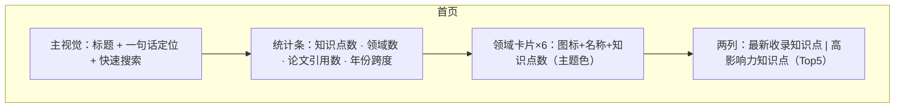
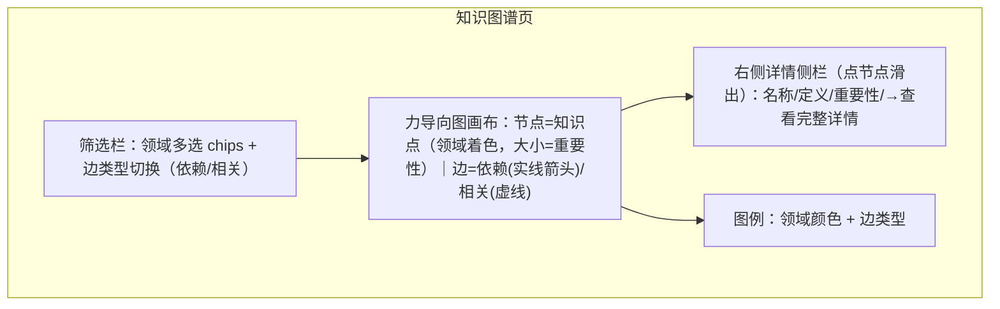
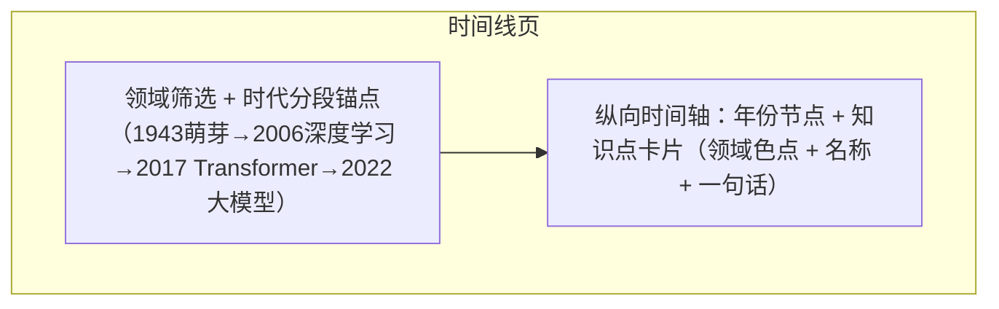
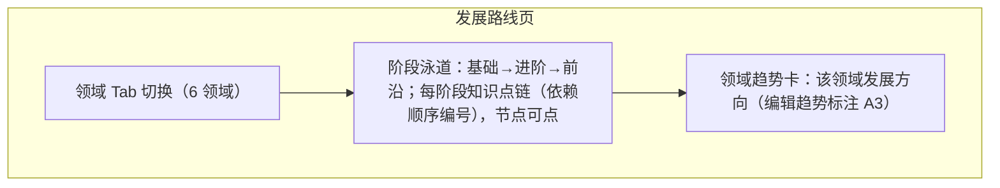
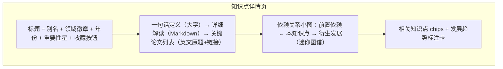
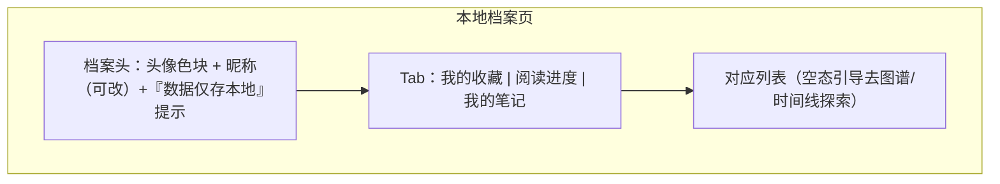

# 原型 — AiIsAllYouNeed v1（Mermaid 线框）

> 覆盖屏：首页 / 知识图谱 / 时间线 / 发展路线 / 领域页 / 知识点详情 / 搜索 / 本地档案。
> 非目标：登录注册屏（本地档案即用即建）、云端同步状态。
> 用例交叉引用：PRD §4 S1–S8。

## 1. 主路径

## 2. 全局框架（六端响应式）

## 3. 首页（S1）

## 4. 知识图谱（S2）

## 5. 时间线（S3）

## 6. 发展路线（S4）

## 7. 知识点详情（S6）

## 8. 本地档案（S7）

## 9. 异常态

| 态 | 入口/表现 |
|----|-----------|
| 搜索无结果 | 搜索下拉显示『未找到，试试：Transformer / 注意力机制』推荐词 |
| 图谱数据为空（筛选后） | 画布中央空态文案 + 重置筛选按钮 |
| 档案未创建 | 点收藏时弹出轻量建档浮层（昵称+选色），可跳过（收藏仍存本地默认档案） |
| 移动端图谱 | 画布支持拖拽/缩放，详情侧栏改为底部抽屉 |
