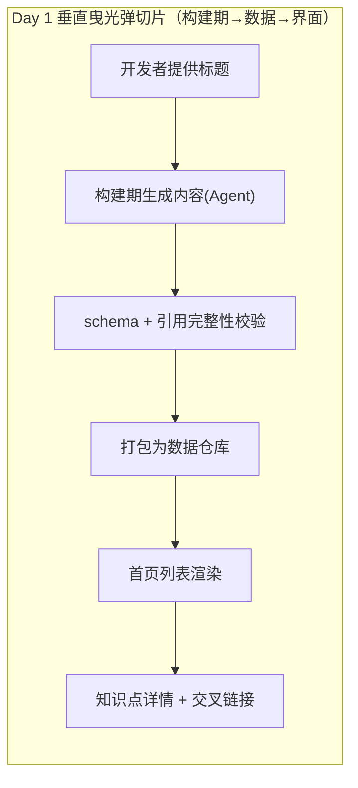
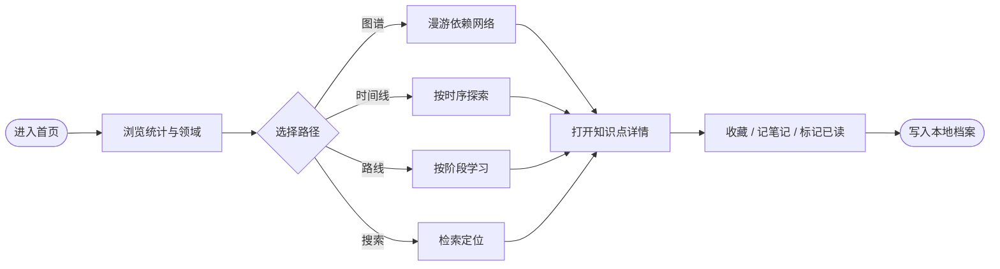
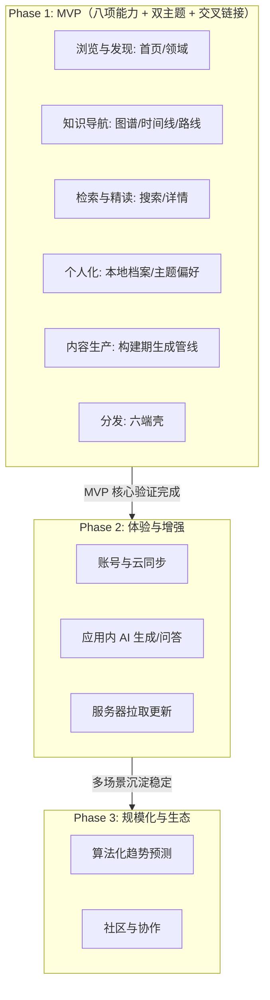

# 产品开发分阶段规划书：AI 知识星图（rebuild_v2）

- **需求/功能名称**：AiIsAllYouNeed · AI 知识星图（整站重建）
- **规划编制时间**：2026-10-16
- **规划状态**：ALIGNED（待随阶段 0 冻结）
- **产品负责人**：开发者（拍板人）
- **当前实施目标**：Phase 1 (MVP) = 全量 v1 八项能力 + 双主题 + 交叉链接
- **关联设计与需求**：
  - 宏观品味宪章：`/DESIGN.md`
  - 全景 PRD：`_02_feature_spec/_01_human_prd/overview_prd.md`
  - 双轨原型：`_02_feature_spec/_04_prototype_wireframe/`
  - 审讯决策日志：`_06_dev_process/_03_qa_log/rebuild_v2_qa_log.md`

> **定位原则**：本规划书是产品设计向工程研发演进的战略桥梁。**MVP 范围已在产品设计沟通（审讯）阶段由开发者裁定**（Q3 = 全量沿用 v1 八项），本规划书仅把结论落盘并分期，杜绝一次性全量以外的一切超前开发。

---

## 1. 核心验证假设、团队胃口 (Appetite) 与 MVP 定位

- **单一核心验证假设 (Single Risky Assumption)**：`以「知识点」为核心的AI知识全景，用图谱/时间线/路线/搜索四种视图互达且一致，能让中文 AI 学习者在 10 秒内看懂全局并 3 秒内定位任一知识点。`
- **团队胃口与时间箱 (Appetite & Timebox)**：`[x] 无硬期限，质量优先`（开发者裁定）；沿用**断路器原则**：遇未知工程阻塞先保核心链路，绝不无谓延期或砍质量门禁。
- **MVP 核心成功指标**：
  1. 首页→任一层→知识点详情，**≤ 2 次点击**可达；
  2. 中文搜索 < 100ms 返回并命中高亮；
  3. 六端同一代码库可构建（Web 必达；桌面/移动按平台工具链）；
  4. 日/夜双主题、图谱/时间线/路线/详情四处视觉一致、互达。
- **总体实施策略**：**小步快跑，垂直曳光弹**。先贯通「标题→生成内容→存库→列表→详情」的最窄端到端通路，再横向铺满八项能力。

---

## 2. 人机交互对齐备忘录 (Interaction Alignment & CEO Cut)

| 对齐维度 | 核心提问内容 | 决策者确认结论与裁剪依据 |
|---|---|---|
| **单一核心假设** | MVP 最根本解决什么？ | 确认聚焦：以知识点为核心的全景展示 + 四视图互达（非论文搜索、非社区）。 |
| **CEO 质疑式裁剪提案** | 对账号/云同步/评论/AI 问答/算法预测发起质疑 | 开发者**未裁剪核心八项**；明确将以下**移出 MVP**：账号云同步、评论社区、论文全文托管、AI 问答、算法化趋势预测、自建服务器 → 归 Phase 2/3 或 Won't-have。 |
| **内容生产策略** | 首期内容怎么来？ | **构建期**由 opencode 依开发者提供的标题检索生成；**No Admin in MVP**（无内容管理后台），内容随 Git 提交。数据层预留可插拔内容源接口。 |
| **管理台策略** | 首期是否做可视化配置后台？ | 遵循 **No Admin**：本地档案用轻量浮层即用即建；内容编辑走 Git/JSON。 |
| **团队胃口** | 时间箱？ | 无硬期限，质量优先；断路器保核心链路。 |
| **首日切片与准出** | MVP 首个垂直切片与准出断言？ | Day-1 贯通「标题 → 生成内容 → 数据契约校验 → 首页列表 → 详情」；准出以 Gherkin 全绿 + 阶段 6 门禁为准。 |

---

## 3. 全量功能池 MoSCoW 分级与分期矩阵

| 功能编号 | 功能名称 | 所属模块 | MoSCoW | 实施阶段 | 裁剪/延期理由 |
|---|---|---|---|---|---|
| `FEAT-001` | 首页全景 | 浏览与发现 | **Must** | **Phase 1** | 冷启动第一屏，核心价值入口 |
| `FEAT-002` | 领域浏览 | 浏览与发现 | **Must** | **Phase 1** | 图谱/时间线/路线的领域维度载体 |
| `FEAT-003` | 知识图谱（依赖网络） | 知识导航 | **Must** | **Phase 1** | 产品名称与差异化核心 |
| `FEAT-004` | 编年时间线 | 知识导航 | **Must** | **Phase 1** | 与图谱互补的时序视图 |
| `FEAT-005` | 领域发展路线 | 知识导航 | **Must** | **Phase 1** | 依赖拓扑 + 分阶段演化 |
| `FEAT-006` | 全局中文搜索 | 检索 | **Must** | **Phase 1** | 3 秒定位知识点 |
| `FEAT-007` | 知识点详情与交叉链接 | 精读 | **Must** | **Phase 1** | 阅读主载体 + 全字段可链接 |
| `FEAT-008` | 本地档案（收藏/进度/笔记） | 个人化 | **Must** | **Phase 1** | 本地用户系统闭环 |
| `FEAT-009` | 主题与阅读偏好 | 个人化 | **Must** | **Phase 1** | 日/夜双主题为视觉基线 |
| `FEAT-010` | 知识内容生产管线 | 内容生产 | **Must** | **Phase 1** | 内容来源；构建期生成 + 可插拔源 |
| `FEAT-011` | 六端分发（Tauri 2） | 分发 | **Must** | **Phase 1** | 「一套代码六端」产品承诺 |
| `FEAT-012` | 账号与云同步 | 个人化 | **Won't** | Phase 2/3 | 无服务器边界；本地档案已满足 v1 |
| `FEAT-013` | 评论 / 社区 | 生态 | **Won't** | Phase 3 | 非核心，反目标 |
| `FEAT-014` | 应用内 AI 实时生成/问答 | 内容生产 | **Won't** | Phase 2/3 | MVP 构建期生成即可；接口已预留 |
| `FEAT-015` | 算法化趋势预测 | 检索 | **Won't** | Phase 3 | v1 用编辑标注趋势 |
| `FEAT-016` | 服务器拉取更新（自建服务器） | 内容生产 | **Won't** | Phase 2/3 | schema 前向兼容，接口已预留 |

> **No Admin in MVP**：内容编辑走 Git/JSON；本地档案即用即建，无配置后台。

---

## 4. 阶段一：MVP 实施细则与垂直切片路径 (Tracer Bullet Path)

### 4.1 Day 1 垂直曳光弹切片 (First Vertical Slice)

- **验证目的**：首个里程碑即跑通「标题 → 生成内容 → 契约校验 → 界面可读」闭环并冒烟演示。

### 4.2 MVP 实施范围 (In-Scope)

- **目标角色**：单一角色 = 本地访客 / 本地档案用户（`ROLE_VISITOR` / `ROLE_LOCAL_USER`）。
- **核心主旅程**：

- **纳入功能清单**：`FEAT-001`～`FEAT-011`。
- **设计语言遵循**：全量继承 `/DESIGN.md`（Aurora Glass，日/夜双主题）。

### 4.3 MVP 明确排除项 (Out-of-Scope / Hard Non-Goals)

- ❌ No Admin：无可视化内容/权限后台；内容走 Git。
- ❌ 无账号、无服务器、无云同步、无评论、无 AI 运行时问答、无算法预测、无论文全文托管。

### 4.4 MVP 准出与验收断言 (Exit Criteria)

- [ ] Day-1 垂直曳光弹切片跑通并可演示；
- [ ] 核心角色 100% 走通八项能力主路径，四视图数据一致、互达；
- [ ] 日/夜双主题、玻璃系统与 `/DESIGN.md` 一致；
- [ ] 中文搜索命中准确、< 100ms；
- [ ] 数据契约校验（schema / 引用完整性 / 依赖环）在构建期拦截坏数据；
- [ ] 测试全绿、静态检查零告警、`verify_consistency` 通过；经阶段 6 门禁本地提交。

---

## 5. 阶段二：体验与能力增强阶段规划 (Phase 2)

- **目标**：账号与云同步、应用内 AI 生成/问答、内容管理增强、通知。
- **规划**：`FEAT-012` 账号与云同步、`FEAT-014` 应用内 AI 生成/问答（接入已预留的 `KnowledgeSource` seam）、高级筛选与批量、服务器拉取更新（`FEAT-016`）。
- **启动前提**：Phase 1 MVP 上线并验证核心链路稳定。

---

## 6. 阶段三：规模化与生态阶段规划 (Phase 3)

- **目标**：算法化趋势预测（`FEAT-015`）、社区与协作（`FEAT-013`）、跨端云同步与开放能力。
- **启动前提**：产品形成规模化使用诉求，核心模型经 Phase 2 考验稳定。

---

## 7. 演进路线图与阶段依赖关系

