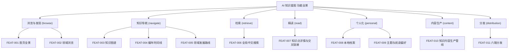

# 产品全景需求总览说明书 (Overview PRD)：AI 知识星图（AiIsAllYouNeed）

- **项目/系统全称**：AiIsAllYouNeed · AI 知识星图
- **创建时间**：2026-10-16
- **版本**：v2.0.0（整站重建）
- **状态**：FROZEN（待开发者签署冻结确认单）
- **宏观品味宪章继承**：`Inherits: /DESIGN.md`
- **对应架构设计**：`hs_dev_docs/_03_architecture_design/_01_system_architecture/`（阶段 2 产出）

> [!NOTE]
> **分级拆分原则**：本项目含 11 个特性（>3），严禁堆入单一巨型 PRD。本总览 PRD 仅承载全局商业愿景、模块划分矩阵与特性索引导航；具体微观特性施工图收敛至 `features/{feature_key}_prd.md`。

---

## 1. 系统业务全景与模块矩阵 (System Scope & Modules)

| 模块标识 | 模块名称 | 核心职责 | 包含特性清单 | 负责人 |
|---|---|---|---|---|
| `browse` | 浏览与发现 | 全景入口、领域导航 | `FEAT-001`, `FEAT-002` | product/frontend |
| `navigate` | 知识导航 | 图谱 / 时间线 / 路线三视图 | `FEAT-003`, `FEAT-004`, `FEAT-005` | product/frontend |
| `retrieve` | 检索 | 中文全局搜索 | `FEAT-006` | product/frontend |
| `read` | 精读 | 知识点详情、交叉链接、反向链接 | `FEAT-007` | product/frontend |
| `personal` | 个人化 | 本地档案、主题与阅读偏好 | `FEAT-008`, `FEAT-009` | product/frontend |
| `content` | 内容生产 | 构建期内容生成管线、可插拔内容源 | `FEAT-010` | product/backend |
| `distribution` | 分发 | 六端打包（Web + Tauri 2） | `FEAT-011` | backend |

---

## 2. 全局功能特性索引映射表 (Feature Index Matrix)

| 特性ID | 特性名称 | 所属模块 | 优先级 | 状态 | 规格说明书路径 (PRD) | 界面原型路径 (Prototype) |
|---|---|---|---|---|---|---|
| `FEAT-001` | 首页全景 | `browse` | P0 | active | `features/feat001_home_prd.md` | `_04_prototype_wireframe/feat001_home_prototype.md` |
| `FEAT-002` | 领域浏览 | `browse` | P0 | active | `features/feat002_domain_prd.md` | `_04_prototype_wireframe/feat002_domain_prototype.md` |
| `FEAT-003` | 知识图谱 | `navigate` | P0 | active | `features/feat003_graph_prd.md` | `_04_prototype_wireframe/feat003_graph_prototype.md` |
| `FEAT-004` | 编年时间线 | `navigate` | P0 | active | `features/feat004_timeline_prd.md` | `_04_prototype_wireframe/feat004_timeline_prototype.md` |
| `FEAT-005` | 领域发展路线 | `navigate` | P0 | active | `features/feat005_roadmap_prd.md` | `_04_prototype_wireframe/feat005_roadmap_prototype.md` |
| `FEAT-006` | 全局中文搜索 | `retrieve` | P0 | active | `features/feat006_search_prd.md` | `_04_prototype_wireframe/feat006_search_prototype.md` |
| `FEAT-007` | 知识点详情与交叉链接 | `read` | P0 | active | `features/feat007_point_detail_prd.md` | `_04_prototype_wireframe/feat007_point_detail_prototype.md` |
| `FEAT-008` | 本地档案 | `personal` | P0 | active | `features/feat008_profile_prd.md` | `_04_prototype_wireframe/feat008_profile_prototype.md` |
| `FEAT-009` | 主题与阅读偏好 | `personal` | P0 | active | `features/feat009_theme_prd.md` | `_04_prototype_wireframe/feat009_theme_prototype.md` |
| `FEAT-010` | 知识内容生产管线 | `content` | P0 | active | `features/feat010_content_pipeline_prd.md` | `_04_prototype_wireframe/feat010_content_pipeline_prototype.md` |
| `FEAT-011` | 六端分发 | `distribution` | P1 | active | `features/feat011_distribution_prd.md` | `_04_prototype_wireframe/feat011_distribution_prototype.md` |

---

## 3. 全局功能架构树 (System Functional Architecture Tree)

---

## 4. 全局用户角色与权限动线 (Global Personas & Access Matrix)

| 角色标识 | 角色名称 | 核心诉求 | 涉及模块 |
|---|---|---|---|
| `ROLE_VISITOR` | 访客 | 免注册快速看懂全局、定位并阅读知识点 | `browse`, `navigate`, `retrieve`, `read` |
| `ROLE_LOCAL_USER` | 本地档案用户 | 收藏、标记已读、记笔记、偏好主题（仅存本机） | `personal`, `read` |
| `ROLE_CONTENT_AUTHOR` | 内容作者（开发者/Agent） | 提供标题、生成并提交知识内容 | `content` |

> **权限模型**：无服务器、无账号、无跨用户权限。访客与本地用户的差异仅在于**本机档案是否已建立**；所有知识内容对所有人只读。

---

## 5. 概念模型（冻结）

| 概念 | 定义 |
|---|---|
| **知识点 KnowledgePoint** | 展示核心单元。字段（沿用 v1 并扩充）：`id` `title` `aliases` `category` `summary`（一句话定义）`body`（详细解读，支持 WikiLink）`year` `importance` `papers` `prerequisites` `derivatives` `related` `trend` **+ 新增：** `tags` 标签 `difficulty` 难度 `learnTime` 学习时长 `media` 媒体/公式。**所有字段支持链接跳转**。 |
| **交叉链接 WikiLink** | 正文与结构化字段中的 `[[知识点标题]]` 语法；系统在构建期解析为内部跳转，并生成**反向链接（backlinks）**从被引用方指回引用方。 |
| **领域 Category** | 知识点的顶层分类，有主题色（仅作点/节点填充）与排序；图谱着色/筛选、时间线/路线分组的维度。 |
| **论文 Paper** | 知识点的支撑引用（标题/作者/年份/会议/链接）；**不是展示主体**。 |
| **发展路线 Roadmap** | 一个领域内知识点的阶段化学习/演化路径（基础→进阶→前沿），由依赖拓扑 + 编辑分阶段生成。 |
| **趋势 Trend** | 编辑整理的方向洞察：领域级趋势 + 知识点级「发展方向」字段（**v1 无算法预测**）。 |
| **本地档案 Profile** | 用户信息仅存本机：昵称、头像色、收藏、阅读进度、笔记、主题偏好；无注册登录、无服务器。 |
| **知识标题清单 (Title List)** | 开发者提供的**唯一内容输入**：知识点标题 + 所属领域。构建期据此检索、理解并生成完整知识点内容。 |

---

## 6. 语言

界面与知识解读用中文；论文标题、作者、专有名词保留英文原文。

---

## 7. 非目标与范围外登记（v1）

- **非目标**：账号云同步、评论社区、论文全文托管、AI 运行时问答、算法化趋势预测、自建更新服务器、可视化内容后台。
- **商业计划**：未提供，跳过不阻断。
- **服务器端 API**：v2（数据契约已按可服务化设计，内容源接口预留）。

---

## 8. 关键约束与质量目标（场景级，非实现细节）

| 维度 | 约束/目标 | 判定方式 |
|---|---|---|
| 首屏 | 10 秒内看懂「AI 知识全景」 | 用户走查（PROD-06） |
| 定位 | 一次搜索 3 秒内定位知识点；客户端索引 < 100ms | 走查 + 测试 |
| 一致性 | 图谱/时间线/路线/详情四视图数据一致、互达 | 数据对账 + 走查 |
| 可达性 | 键盘可达、触控目标 ≥ 44px、对比度 WCAG AA | a11y 走查 |
| 隐私 | 无账号、无网络上传；档案仅本机 | 走查 + 代码审查 |
| 双主题 | 日/夜双主题均满足以上 | 走查 |
| 数据健壮 | 坏数据（schema/引用/依赖环）在构建期被拦截 | 构建期校验 + 测试 |

---

## 9. 一源双视图与对账（PROD-09）

- 已验收范围 ↔ REQ ↔ 规则/场景 ↔ 原型/Vibe Spec 的对应关系，逐特性维护于各子 PRD 与 `_04_prototype_wireframe/` 的映射矩阵中。
- 冻结基线：`/DESIGN.md`(v5)、`overview_prd.md`(v2.0.0)、11 份子 PRD、11 份原型、11 份 Vibe Spec、`rebuild_v2_phased_plan.md`。
