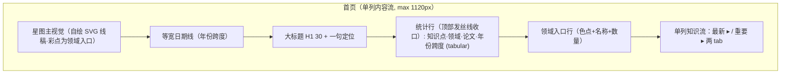

# 界面原型（双轨）：首页全景

- **功能模块**：`FEAT-001` 首页全景 · **目标端**：`[x] Web(Responsive)` `[x] 桌面` `[x] 移动`
- **继承**：`Inherits: /DESIGN.md` · **关联 PRD**：`.../features/feat001_home_prd.md`
- **状态**：FROZEN（待视觉签收）

## 1. 空间拓扑（Mermaid）



## 2. 正常态线框（Populated）

```text
+--------------------------------------------------------------------------------------+
| [UI: canvas #E9EDF4 + 极光光斑; 顶栏玻璃 56px 悬浮圆角18, blur20]                    |
| [AI 知识星图]              [ 🔍 搜索 ⌘K ]            [ ◐ 主题 ]  [ ○ 档案 ]          |
+--------------------------------------------------------------------------------------+
|  ·  ·      ·        ·          ·        ·       ·                                     |
|     ·   ●━━●━━●   ●━━●    ·  ●━━●  ●━━●   ·   [星图主视觉: 彩点=领域入口(6), 墨点织网]|
|  ·    ●   ·   ●━━━●   ·   ·    ●━●   ·                                                  |
|                                                                                      |
|  1943 — 2026                                                                         |
|  一份 AI 知识的全景星图 [H1: 30px w640 --ink]                                        |
|  ────────────────────────────────────────────────────────────────────────────        |
|  94 知识点 · 6 领域 · 72 论文 · 83 年跨度   [tabular-nums, --ink-3 12.5px]            |
|                                                                                      |
|  机器学习基础 ● 18   自然语言处理 ● 16   计算机视觉 ● 15   强化学习 ● 12              |
|  大模型与生成 ● 20   数学与理论 ● 13                                                 |
|  ────────────────────────────────────────────────────────────────────────────        |
|  [ 最新 ▸ ]  [ 重要 ]              ← 玻璃 pill，选中=accent 浅底                     |
|  Transformer      · 大模型与生成 2017   一句话定义…                                  |
|  注意力机制       · 大模型与生成 2014   一句话定义…                                  |
|  反向传播         · 机器学习基础 1986   一句话定义…                                  |
|  [ 查看全部 ▸ ]                                                                      |
+--------------------------------------------------------------------------------------+
  [注] 首屏强调色 ≤ 3 处：搜索焦点 / 选中 pill / 「查看全部」。领域色只在圆点。
```

## 3. 移动端线框（390px）

```text
+------------------------------------------+
| [顶栏玻璃 48px] AI 知识星图   [🔍][◐][○]  |
+------------------------------------------+
|  ·  ·    ●━━●━━●    ·   ●━━●  [星图缩小]  |
|  1943 — 2026                              |
|  一份 AI 知识的全景星图 (H1 26)           |
|  94 · 6 · 72 · 83 年                      |
|  ● 机器学习基础 18                        |
|  ● 自然语言处理 16                        |
|  …                                        |
|  [最新▸][重要]                            |
|  Transformer · 大模型与生成 2017          |
+------------------------------------------+
| [首页●] [图谱] [时间线] [路线] [档案]     | ← 玻璃底部 Tab（安全区）
+------------------------------------------+
```

## 4. 四态

| 态 | 表现 |
|---|---|
| 正常 | 上表 |
| 空白/异常空 | 隐藏星图；文案「知识数据暂不可用」+ [前往图谱] ★ / [打开搜索] |
| 加载 | 星图占位虚线 + 标题/统计/列表 1:1 骨架脉冲（CLS=0） |
| 异常 | 同「空白/异常空」，保留顶栏，主 CTA 为 [重新加载] |

## 5. 映射矩阵

| 原型节点 | PRD | DoD |
|---|---|---|
| 统计行 | `FEAT-001` REQ-001 | 浏览主成功流 |
| 领域入口/彩点 | `FEAT-001` REQ-002 | 领域跳转 |
| 单列知识流 | `FEAT-001` REQ-003 | 详情跳转 |
| 星图减动效 | `FEAT-001` REQ-004 | 无障碍 |
| 空态 | `FEAT-001` REQ-005 | 冷启动 |
