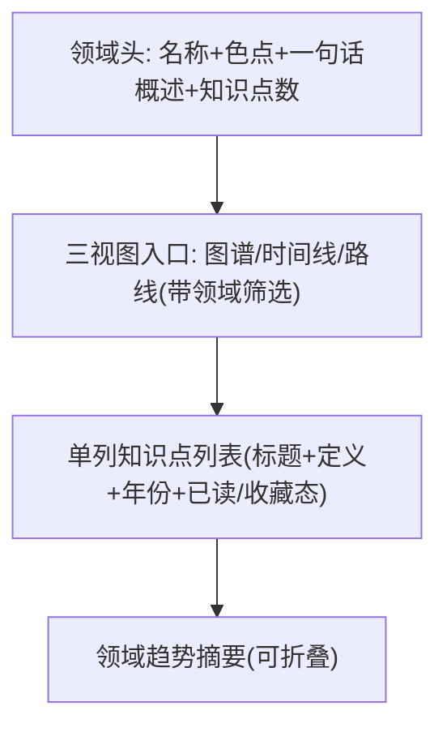

# 界面原型（双轨）：领域浏览

- **功能模块**：`FEAT-002` · **目标端**：Web/桌面/移动 · **继承**：`Inherits: /DESIGN.md`
- **关联 PRD**：`.../features/feat002_domain_prd.md` · **状态**：FROZEN（待视觉签收）

## 1. 空间拓扑



## 2. 正常态线框

```text
+--------------------------------------------------------------------------+
| [顶栏玻璃] AI 知识星图     [ 🔍 ⌘K ]        [ ◐ ]  [ ○ ]                 |
+--------------------------------------------------------------------------+
| ● 自然语言处理                         16 知识点                          |
| 让机器理解与生成人类语言的 AI 分支……                                     |
| [ 在图谱中查看 ] [ 时间线 ] [ 路线 ]      ← 携带领域筛选, 玻璃次按钮      |
| ────────────────────────────────────────────────────────────────────     |
| 词向量 Word2Vec        2013   把词映射为稠密向量……                       |
| 注意力机制             2014   让模型关注输入的相关部分……                  |
| Transformer            2017   完全基于注意力的序列架构……                  |
| …                                                                        |
| ▸ 领域趋势：向预训练大模型统一演进……（可折叠）                            |
+--------------------------------------------------------------------------+
```

## 3. 四态

| 态 | 表现 |
|---|---|
| 正常 | 上方 |
| 空 | 「该领域暂无知识点」+ [去图谱探索] ★ |
| 加载 | 领域头 + 列表 1:1 骨架脉冲 |
| 异常 | 「领域数据加载失败」+ [重试]（保留领域） |

## 4. 映射矩阵

| 节点 | PRD | DoD |
|---|---|---|
| 领域头 | REQ-001 | 展示与数据一致 |
| 列表 | REQ-002 | 进详情 |
| 三视图入口 | REQ-003 | 携带筛选 |
| 非法领域兜底 | REQ-004 | 空态返回 |
