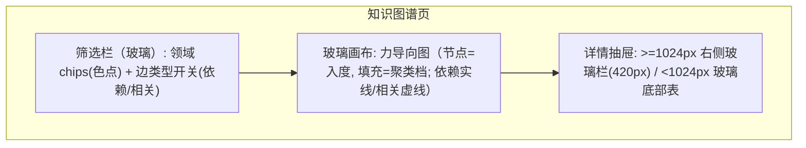

# 界面原型（双轨）：知识图谱

- **功能模块**：`FEAT-003` · **目标端**：Web/桌面/移动 · **继承**：`Inherits: /DESIGN.md`
- **关联 PRD**：`.../features/feat003_graph_prd.md` · **状态**：FROZEN（待视觉签收）

## 1. 空间拓扑（Mermaid）



## 2. 正常态线框（桌面 ≥1024px）

```text
+--------------------------------------------------------------------------------------+
| [顶栏玻璃] AI 知识星图     [ 🔍 ⌘K ]              [ ◐ ]  [ ○ ]                        |
+--------------------------------------------------------------------------------------+
| 领域: (●全部) (●机器学习) (●NLP) (●CV) …     边: [依赖] [相关]                        |
| [chips: pill 玻璃; 选中=accent 浅底; 圆点=领域色]                                     |
+--------------------------------------------------------------------------+-----------+
|                                                                          | ● Transformer|
|        ●━━━●                 ●━━●                                       | 大模型与生成 2017|
|      ╱   ╲  ╲              ╱    ╲                                        | 一句话定义……  |
|    ●      ●   ●━━━●       ●      ●━━●          [玻璃画布 blur20]        | ─────────── |
|      ╲   ╱        ╲      ╱                                              | 依赖: 注意力  |
|        ●            ●━━●                         精度: hover 聚焦邻域    | 相关: BERT   |
|   节点尺寸=入度; 标签按需显示                                            | [查看完整详情 ▸]|
+--------------------------------------------------------------------------+-----------+
  [注] 概览无箭头；点节点→右侧抽屉；拖拽/缩放画布；移动端抽屉改底部表。
```

## 3. 移动端（390px）与四态

```text
+---------------------------+     四态:
| AI 知识星图   [🔍][◐][○]  |     - 正常: 上方
| [领域▾]              [边▾]|     - 空(筛选无结果): 画布中央文案「没有匹配的节点」+ [重置筛选] ★
|      ●━━●                 |     - 加载: 玻璃画布脉冲骨架 + 筛选栏骨架 (CLS=0)
|    ●     ●━━●             |     - 异常: 画布内「图谱数据加载失败」+ [重新加载]（保留筛选）
|      ●━━●                 |
+---------------------------+     - 点节点 → 玻璃底部表(含安全区)滑出
| ▔▔ 抽屉(底部表) ▔▔        |
| Transformer  大模型 2017  |
| [查看完整详情 ▸]          |
+---------------------------+
| [首页][图谱●][时间线][路线][档案] |
+---------------------------+
```

## 4. 映射矩阵

| 原型节点 | PRD | DoD |
|---|---|---|
| 画布节点/边 | REQ-001 | 图结构正确 |
| 领域 chips/边开关 | REQ-002 | 筛选生效 |
| 详情抽屉 | REQ-003 | 打开详情 |
| hover 邻域 | REQ-004 | 聚焦 |
| 空态重置 | REQ-005 | 恢复 |
