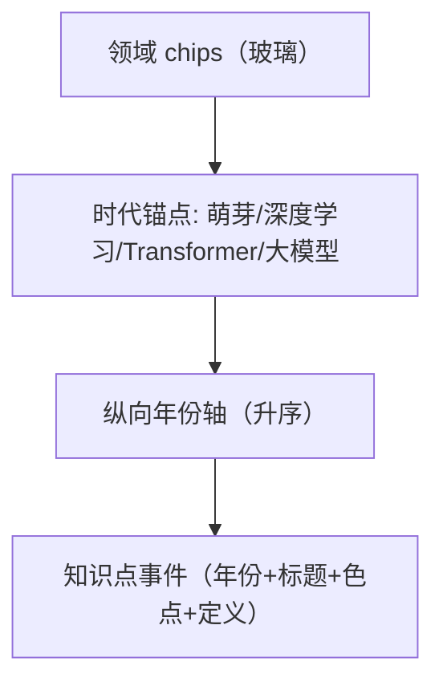

# 界面原型（双轨）：编年时间线

- **功能模块**：`FEAT-004` · **目标端**：Web/桌面/移动 · **继承**：`Inherits: /DESIGN.md`
- **关联 PRD**：`.../features/feat004_timeline_prd.md` · **状态**：FROZEN（待视觉签收）

## 1. 空间拓扑



## 2. 正常态线框

```text
+--------------------------------------------------------------------------+
| [顶栏玻璃] AI 知识星图     [ 🔍 ⌘K ]        [ ◐ ]  [ ○ ]                 |
+--------------------------------------------------------------------------+
| 领域: (●全部) (●NLP) (●CV) …            ← 玻璃 chips, 圆点=领域色         |
|                                                                          |
| ▸ 2012 深度学习时代                                                      |
| 2012 ● AlexNet          计算机视觉   卷积网络夺冠 ImageNet……              |
| 2014 ● 注意力机制        大模型与生成 让模型关注输入的相关部分……           |
| 2017 ● Transformer       大模型与生成 完全基于注意力的序列架构……          |
| ▸ 2022 大模型时代                                                        |
| 2022 ● ChatGPT           大模型与生成 对话式大模型……                      |
| 2024 ● 多模态统一         大模型与生成 统一文本/图像/音频的理解……          |
+--------------------------------------------------------------------------+
```

## 3. 四态

| 态 | 表现 |
|---|---|
| 正常 | 上方 |
| 空（筛选无命中） | 「该筛选下没有事件」+ [重置筛选] ★ |
| 加载 | 轴 + 事件行 1:1 骨架脉冲 |
| 异常 | 「时间线加载失败」+ [重试]（保留筛选） |

## 4. 映射矩阵

| 节点 | PRD | DoD |
|---|---|---|
| 年份轴/事件 | REQ-001 | 升序正确 |
| 领域 chips | REQ-002 | 筛选+轴压缩 |
| 时代锚点 | REQ-003 | 折叠/定位 |
| 事件点击 | REQ-004 | 进详情 |
