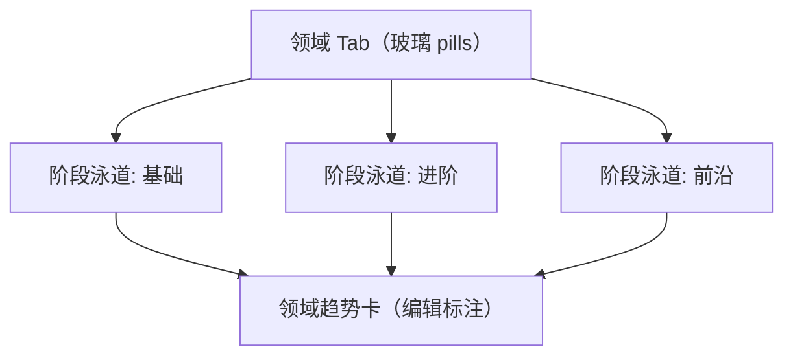

# 界面原型（双轨）：领域发展路线

- **功能模块**：`FEAT-005` · **目标端**：Web/桌面/移动 · **继承**：`Inherits: /DESIGN.md`
- **关联 PRD**：`.../features/feat005_roadmap_prd.md` · **状态**：FROZEN（待视觉签收）

## 1. 空间拓扑



## 2. 正常态线框

```text
+--------------------------------------------------------------------------+
| [顶栏玻璃] AI 知识星图     [ 🔍 ⌘K ]        [ ◐ ]  [ ○ ]                 |
+--------------------------------------------------------------------------+
| [机器学习基础●] [自然语言处理] [计算机视觉] [强化学习] …                  |
| ────────────────────────────────────────────────────────────────────     |
| 基础   ① 线性回归   ② 逻辑回归   ③ 梯度下降                              |
| 进阶   ④ 反向传播   ⑤ CNN        ⑥ RNN                                  |
| 前沿   ⑦ Transformer  ⑧ 自监督学习                                       |
| [节点 = 依赖拓扑序编号 + 色点; 点击进入详情]                              |
| ────────────────────────────────────────────────────────────────────     |
| ▸ 领域趋势：向自监督与基础模型统一演进……                                 |
+--------------------------------------------------------------------------+
```

## 3. 四态

| 态 | 表现 |
|---|---|
| 正常 | 上方 |
| 空（该领域无路线） | 「该领域暂无路线」+ [去图谱探索] ★ |
| 加载 | Tab + 泳道 1:1 骨架脉冲 |
| 异常 | 「路线加载失败」+ [重试] |

## 4. 映射矩阵

| 节点 | PRD | DoD |
|---|---|---|
| 三阶段泳道 | REQ-001 | 阶段+拓扑序 |
| 顺序合法性 | REQ-002 | 前置在先/无环 |
| 节点点击 | REQ-003 | 进详情 |
| 趋势卡 | REQ-004 | 与标注一致 |
