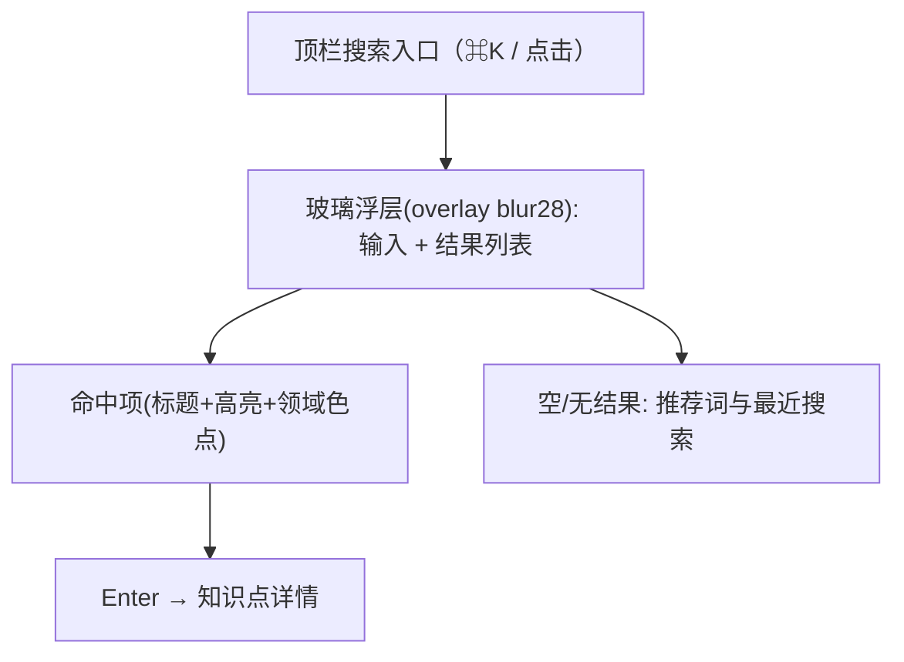

# 界面原型（双轨）：全局中文搜索

- **功能模块**：`FEAT-006` · **目标端**：Web/桌面/移动 · **继承**：`Inherits: /DESIGN.md`
- **关联 PRD**：`.../features/feat006_search_prd.md` · **状态**：FROZEN（待视觉签收）

## 1. 空间拓扑



## 2. 正常态线框

```text
+--------------------------------------------------------------------------+
|                              (画布变暗, overlay)                          |
|      +--------------------------------------------------------------+    |
|      | 🔍  注意力                                          Esc 关闭   |    |
|      |──────────────────────────────────────────────────────────────|    |
|      | ● 注意力机制        大模型与生成 2014  让模型关注「注意力」…   |    |
|      | ● 自注意力          大模型与生成 2017  「注意力」的变体……      |    |
|      | ● Transformer       大模型与生成 2017  基于「注意力」……       |    |
|      |──────────────────────────────────────────────────────────────|    |
|      | ↑↓ 选择   Enter 打开                                      3 项 |    |
|      +--------------------------------------------------------------+    |
+--------------------------------------------------------------------------+
```

## 3. 空查询 / 无结果 / 四态

```text
空查询:                        无结果:
+----------------------+       +----------------------+
| 🔍 输入以搜索……      |       | 🔍 zzzz              |
| 推荐: Transformer    |       | 未找到相关知识点      |
|      注意力机制      |       | 试试: Transformer     |
| 最近: 反向传播       |       |       注意力机制      |
+----------------------+       +----------------------+
```
| 态 | 表现 |
|---|---|
| 正常 | 命中高亮 |
| 空查询 | 推荐词 + 最近搜索（本机） |
| 无结果 | 「未找到」+ 推荐词 |
| 异常 | 「搜索索引不可用」+ 提示重开应用 |

## 4. 映射矩阵

| 节点 | PRD | DoD |
|---|---|---|
| 输入/命中 | REQ-001 | 命中+高亮 |
| 键盘操作 | REQ-002 | Enter/Esc |
| 空/无结果 | REQ-003 | 引导 |
| 性能 | REQ-004 | <100ms |
