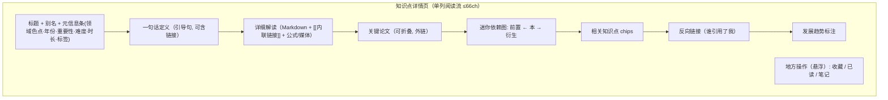

# 界面原型（双轨）：知识点详情与交叉链接

- **功能模块**：`FEAT-007` · **目标端**：Web/桌面/移动 · **继承**：`Inherits: /DESIGN.md`
- **关联 PRD**：`.../features/feat007_point_detail_prd.md` · **状态**：FROZEN（待视觉签收）

## 1. 空间拓扑（Mermaid）



## 2. 正常态线框（桌面）

```text
+--------------------------------------------------------------------------------------+
| [顶栏玻璃] AI 知识星图     [ 🔍 ⌘K ]              [ ◐ ]  [ ○ ]                        |
+--------------------------------------------------------------------------------------+
| Transformer                                                                          |
| 别名: Transformer 模型 · Attention Is All You Need                                   |
| ● 大模型与生成  2017   ★★★★☆  难度 高  ~45min   #注意力 #Seq2Seq #编码器            |
| ──────────────────────────────────────────────────────────────────────────────       |
| [阅读容器 --surface(近不透明), 正文衬线 ≤68ch 居中, 17.5/1.95]                       |
| 一种完全基于 [[注意力机制]] 的序列到序列架构，抛弃了 [[循环神经网络]] 的循环结构……    |
| [内联链接=accent 下划线; hover 显示气泡预览标题]                                      |
|                                                                                      |
| （公式） Attention(Q,K,V) = softmax(QKᵀ/√d)·V                                        |
|                                                                                      |
| ▸ 关键论文 (2)                                                                        |
|   Attention Is All You Need — Vaswani et al., 2017, NeurIPS  [↗ 外链]                |
| ──────────────────────────────────────────────────────────────────────────────       |
| 依赖小图:  [[RNN]] ─▶ [Transformer] ─▶ [[BERT]] / [[GPT]]     [点击节点跳转]          |
| 相关知识点: (注意力机制) (BERT) (位置编码) …                                          |
| 反向链接: 被 [[BERT]]、[[GPT]]、[[自注意力]] 引用                                      |
| 发展趋势: 向更长上下文与多模态统一架构演进……                                          |
+--------------------------------------------------------------------------------------+
| [悬浮玻璃条： ♥ 收藏  ✓ 已读  ✎ 笔记 ]   ← 功能按需浮现, 触摸 ≥44px                   |
+--------------------------------------------------------------------------------------+
```

## 3. 移动端（390px）与四态

```text
+---------------------------+   四态:
| ← Transformer  [♥][✓][✎]  |    - 正常: 单列；悬浮操作条贴底
| ● 大模型 2017 ★★★★☆       |    - 空(缺正文): 「该知识点正文生成中」+ [返回/图谱]
| 一种完全基于 [[注意力机制]]|    - 加载: 标题/正文骨架 1:1 脉冲
| 的序列到序列架构……        |    - 异常: 「内容加载失败」+ [重试]；已选筛选/滚动位保留
| （公式块）                 |
| ▸ 关键论文               |
| RN N ─▶ 本 ─▶ BERT        |
| 相关 / 反向链接 / 趋势    |
+---------------------------+
```

## 4. 映射矩阵

| 原型节点 | PRD | DoD |
|---|---|---|
| 详情各区块 | REQ-001 | 渲染完整 |
| `[[内联链接]]` | REQ-002 | 顺链跳转 |
| 元信息/依赖/相关/论文 | REQ-003 | 结构化跳转 |
| 反向链接 | REQ-004 | 反向跳转 |
| 悬浮操作条 | REQ-005 | 本地持久化 |
| 缺字段降级 | REQ-006 | 无空占位破版 |
