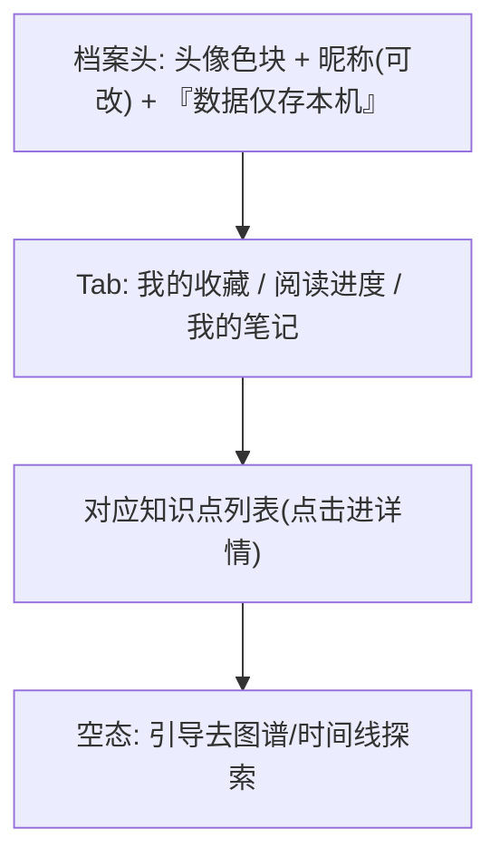

# 界面原型（双轨）：本地档案

- **功能模块**：`FEAT-008` · **目标端**：Web/桌面/移动 · **继承**：`Inherits: /DESIGN.md`
- **关联 PRD**：`.../features/feat008_profile_prd.md` · **状态**：FROZEN（待视觉签收）

## 1. 空间拓扑



## 2. 正常态 / 建档浮层 / 四态

```text
正常:                                    建档浮层(首次收藏):
+--------------------------------------+ +--------------------------+
| [顶栏玻璃]        [◐]  [○ 奶油]      | | 建立本地档案              |
+--------------------------------------+ | 昵称: [ 学习者____ ]      |
| ○ 学习者       数据仅存本机           | | 颜色: ● ● ● ● ● ●         |
| [我的收藏][阅读进度][我的笔记]        | | [ 建立 ] [ 稍后 ]         |
| ──────────────────────────────────── | +--------------------------+
| ♥ Transformer      大模型与生成 2017 |   四态:
| ♥ 注意力机制       大模型与生成 2014 |    - 正常: 左
|                                       |    - 空: 「还没有收藏/笔记」+ [去图谱探索] ★
+--------------------------------------+    - 加载: 列表骨架
                                            - 异常: 「本地档案读取失败」+ [重试]
```

## 3. 映射矩阵

| 节点 | PRD | DoD |
|---|---|---|
| 建档浮层 | REQ-001 | 即用即建/可跳过 |
| 收藏列表 | REQ-002 | 持久化 |
| 阅读进度 | REQ-003 | 一致 |
| 笔记 | REQ-004 | 持久化 |
| 无网络 | REQ-005 | 无上传 |
| 空态 | REQ-006 | 引导 |
