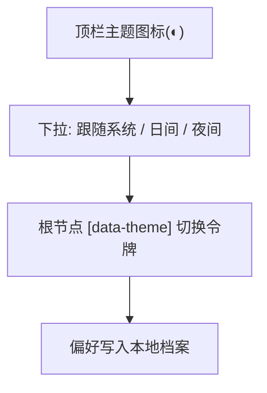

# 界面原型（双轨）：主题与阅读偏好

- **功能模块**：`FEAT-009` · **目标端**：全端 · **继承**：`Inherits: /DESIGN.md`（§2 色表、§8 主题切换）
- **关联 PRD**：`.../features/feat009_theme_prd.md` · **状态**：REVISED（v6）
- **唯一性**：全站**仅此一个**主题控件；演示壳/其它页面**不得**再放主题开关（v6 铁律，§12）。

## 1. 空间拓扑



## 2. 正常态：日 / 夜 双主题对照

```text
日间(暖纸 + 清透玻璃)                        夜间(深墨 + 微光玻璃)
+------------------------------------+     +------------------------------------+
| [玻璃白 0.52; 画布 #EFEBE3]        |     | [玻璃暗 0.55; 画布 #0B0D12]        |
| 知识星图   [🔍 搜索]  [◐]  [○]     |     | 知识星图   [🔍 搜索]  [◐]  [○]     |
| Transformer  ★★★★☆  ● 大模型      |     | Transformer  ★★★★☆  ● 大模型      |
| attention…  (ink #1B1A17 on .86)   |     | attention…  (ink #ECE9E2 on .88)   |
+------------------------------------+     +------------------------------------+
   [◐] 点开（L3 玻璃小面板）:  ◉ 跟随系统   ○ 日间   ○ 夜间
```

## 3. 四态 / 规则

| 态 | 表现 |
|---|---|
| 未设置 | 跟随系统（首屏前内联注入，无闪烁） |
| 已设置 | 覆盖并持久化 |
| 系统变化且「跟随」 | 实时切换 |
| 异常（存储不可用） | 会话内存态，提示不阻断 |

**对比度护栏**：两主题正文有效对比度 ≥ 4.5:1（玻璃合成后）。

## 4. 映射矩阵

| 节点 | PRD | DoD |
|---|---|---|
| 默认跟随系统 | REQ-001 | 首次=系统 |
| 手动切换 | REQ-002 | 持久化 |
| 无闪烁 | REQ-003 | 首屏无闪变 |
| 对比度 | REQ-004 | ≥4.5:1 |
