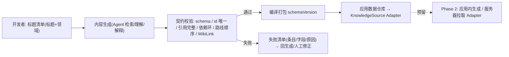

# 界面原型（双轨）：知识内容生产管线

- **功能模块**：`FEAT-010` · **形态**：构建期流程（无终端用户 UI） · **继承**：`Inherits: /DESIGN.md`
- **关联 PRD**：`.../features/feat010_content_pipeline_prd.md` · **状态**：FROZEN（待视觉签收）

> 本特性无面向用户的界面；此处以**流程拓扑**替代 UI 线框，并按阶段契约产出可控状态。

## 1. 流程拓扑（Mermaid）

## 2. 产出与状态（等价于四态）

| 态 | 表现 |
|---|---|
| 正常 | 校验通过 → 打包成功，输出条目统计 |
| 空（无标题） | 提示「尚未提供标题清单」→ 不打包（阻断） |
| 加载 | 生成/校验进行中日志与进度 |
| 异常 | 校验失败 → 精确失败清单（哪个知识点/哪个字段/为什么，含依赖环路径），阻断打包 |

## 3. 契约字段（生成内容须覆盖，详见阶段 3 详设）

`id · title · aliases · category · summary · body(WikiLink) · year · importance · papers · prerequisites · derivatives · related · trend · tags · difficulty · learnTime · media · schemaVersion`

## 4. 映射矩阵

| 节点 | PRD | DoD |
|---|---|---|
| 标题→生成 | REQ-001 | 字段齐全可溯源 |
| 校验 | REQ-002/003 | 拦截坏数据/环 |
| KnowledgeSource | REQ-004 | 可插拔 seam |
| schemaVersion | REQ-005 | 版本检查 |
| 阻断打包 | REQ-006 | 坏数据不进产品 |
