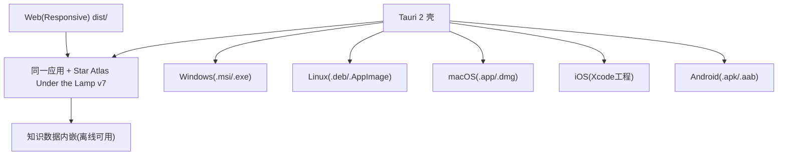

# 界面原型（双轨）：六端分发

- **功能模块**：`FEAT-011` · **形态**：分发与运行形态（跨端一致） · **继承**：`Inherits: /DESIGN.md`（§10 响应式）
- **关联 PRD**：`.../features/feat011_distribution_prd.md` · **状态**：FROZEN（待视觉签收）

## 1. 跨端拓扑（Mermaid）



## 2. 响应式对照线框

```text
桌面/Web (≥1024):                          移动 (<1024, 390):
+------------------------------------+     +----------------------+
| [顶栏玻璃 56px 悬浮]               |     | [顶栏玻璃 48px]      |
| 主内容列 max1120                   |     | 主内容列             |
| 图谱: 右侧玻璃栏 420px             |     | 图谱: 底部玻璃抽屉   |
+------------------------------------+     +----------------------+
|                                            | [首页][图谱][时间线] |
|                                            | [路线][档案] 底部Tab |
|                                            | safe-area-inset 适配 |
+------------------------------------+     +----------------------+
```

## 3. 四态 / 平台规则

| 项 | 规则 |
|---|---|
| 正常 | 各端同一套断点 640/1024 与主题 |
| 离线 | 数据内嵌，断网完整可浏览 |
| 触控 | ≥44px；移动顶栏/底栏/抽屉用 `env(safe-area-inset-*)` |
| 构建 | Web 必达；桌面/移动按平台工具链执行，交付配置+文档 |

## 4. 映射矩阵

| 节点 | PRD | DoD |
|---|---|---|
| Web 构建 | REQ-001 | dist 可离线打开 |
| 六端配置 | REQ-002 | 配置齐备 |
| 跨端一致 | REQ-003 | 体验一致 |
| 安全区/触控 | REQ-004 | 适配正确 |
| 离线 | REQ-005 | 断网可用 |
