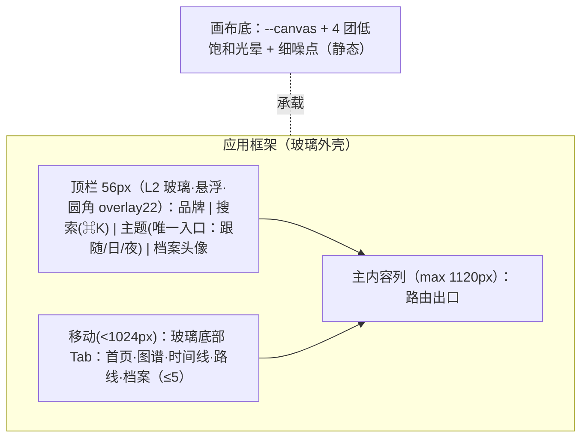

# 双轨原型总览：AI 知识星图（rebuild_v2）

- **介质形式**：双轨原型（Mermaid 空间拓扑 + ASCII 空间比例线框）· 日/夜双主题 · **视觉真理源：`_03_prototype_html/overview_prototype.html`（v7 星图册·台灯下）**
- **宏观品味宪章继承**：`Inherits: /DESIGN.md`（v7 Star Atlas）
- **状态**：REVISED（v6 · 待开发者视觉签收）
- **覆盖屏**：首页 / 领域页 / 图谱 / 时间线 / 路线 / 搜索浮层 / 知识点详情 / 本地档案 / 主题切换 / 内容管线 / 六端

## 1. 全局主路径（页面流转）

```mermaid
flowchart LR
  Home[首页] -->|领域入口| Domain[领域页]
  Home -->|导航| Graph[知识图谱]
  Home -->|导航| Timeline[时间线]
  Home -->|导航| Roadmap[发展路线]
  Home -->|⌘K/搜索| Search[搜索浮层]
  Domain -->|三视图入口| Graph & Timeline & Roadmap
  Domain -->|点知识点| Detail[知识点详情]
  Graph -->|点节点| Detail
  Timeline -->|点事件| Detail
  Roadmap -->|点节点| Detail
  Search -->|选结果| Detail
  Detail -->|内联 [[链接]] / 依赖 / 相关| Detail
  Detail -->|收藏/笔记| Profile[本地档案]
  Profile -->|点条目| Detail
```

## 2. 全局框架（六端响应式 · 玻璃外壳）



## 3. 设计令牌速查（继承 `/DESIGN.md`）

- 玻璃：**仅三种用途**——灯罩（顶栏/浮层）、透镜（悬停/选中聚焦）、展柜（图谱画布/阅读面）；统一 `blur 24` + 光边 + 暖渐变；**列表/卡片/chip 一律纸面 + 发丝线，不贴玻璃**。
- 色：日 `--canvas #F7F3EA` / `--accent #A96812`（琥珀台灯）；夜 `--canvas #12100B` / `--accent #F2B64B`（台灯暖金）；领域色仅星点/节点。
- 字：**粗重黑体标题（Space Grotesk）+ Inter 界面 + 衬线只给读书 + Mono 数据**；层级 `Display44/H1 30/H2 18/H3 15/Body15/Reading17.5/Caption12.5`。
- 圆角：`chip999 / control10 / panel14 / case18`（同心圆角）。
- 台灯：页面顶部暖金主光源；日/夜 = 灯关/灯开。

## 4. 四态通用约定（每页适用）

| 态 | 表现 |
|---|---|
| 正常 (Populated) | 玻璃外壳 + 单列内容；功能按需浮现 |
| 空白 (Empty/FTUE) | 文案 + 唯一主 CTA（如「开始探索」/「重置筛选」），虚线框为 `--glass` 区域，非插画堆砌 |
| 加载 (Loading) | 1:1 骨架（玻璃脉冲），CLS=0 |
| 异常 (Error) | 人话原因 + 原位重试；保留已选筛选 |

> 各页专属四态与 ASCII 线框见 `feat0xx_*_prototype.md`。
