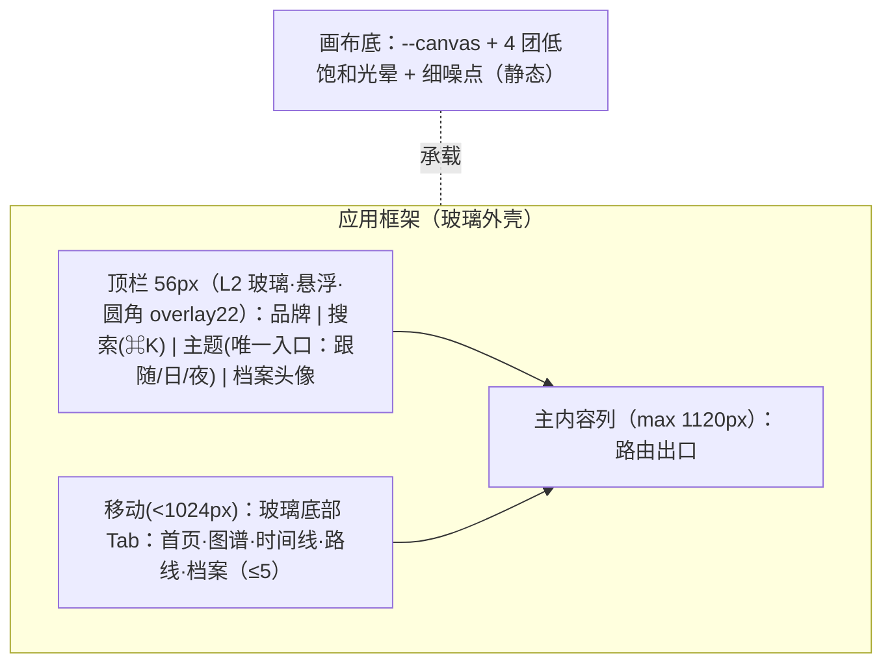

# 双轨原型总览：AI 知识星图（rebuild_v2）

- **介质形式**：双轨原型（Mermaid 空间拓扑 + ASCII 空间比例线框）· 日/夜双主题 · **视觉真理源：`_03_prototype_html/overview_prototype.html`（v6 琉璃）**
- **宏观品味宪章继承**：`Inherits: /DESIGN.md`（Liuli Glass v6）
- **状态**：REVISED（v6 · 待开发者视觉签收）
- **覆盖屏**：首页 / 领域页 / 图谱 / 时间线 / 路线 / 搜索浮层 / 知识点详情 / 本地档案 / 主题切换 / 内容管线 / 六端

## 1. 全局主路径（页面流转）

```mermaid
flowchart LR
  Home[首页] -->|领域入口| Domain[领域页]
  Home -->|导航| Graph[知识图谱]
  Home -->|导航| Timeline[时间线]
  Home -->|导航| Roadmap[发展路线]
  Home -->|⌘K/搜索| Search[搜索浮层]
  Domain -->|三视图入口| Graph & Timeline & Roadmap
  Domain -->|点知识点| Detail[知识点详情]
  Graph -->|点节点| Detail
  Timeline -->|点事件| Detail
  Roadmap -->|点节点| Detail
  Search -->|选结果| Detail
  Detail -->|内联 [[链接]] / 依赖 / 相关| Detail
  Detail -->|收藏/笔记| Profile[本地档案]
  Profile -->|点条目| Detail
```

## 2. 全局框架（六端响应式 · 玻璃外壳）



## 3. 设计令牌速查（继承 `/DESIGN.md`）

- 玻璃：**三级厚玻璃** `L1 blur14 / L2 blur24 / L3 blur34` + **光边(inset ring) + 底部厚度 + 色散暗示 + 悬浮光泽(跟随光标)**；阅读面用 `--surface`（近不透明 ≥0.90）。**禁止 1px 实描边**。
- 色：日 `--canvas #EFEBE3` / `--accent #0E7C7B`；夜 `--canvas #0B0D12` / `--accent #5EEAD4`；领域色仅功能点。
- 字：**四角色** `衬线(Display/Reading) + Inter(Text) + JetBrains Mono(Mono)`；层级 `Display46/H1 32/H2 19/H3 15/Body15/Reading17/Caption12.5`。
- 圆角：`chip999 / control10 / panel16 / overlay22`（同心圆角）。

## 4. 四态通用约定（每页适用）

| 态 | 表现 |
|---|---|
| 正常 (Populated) | 玻璃外壳 + 单列内容；功能按需浮现 |
| 空白 (Empty/FTUE) | 文案 + 唯一主 CTA（如「开始探索」/「重置筛选」），虚线框为 `--glass` 区域，非插画堆砌 |
| 加载 (Loading) | 1:1 骨架（玻璃脉冲），CLS=0 |
| 异常 (Error) | 人话原因 + 原位重试；保留已选筛选 |

> 各页专属四态与 ASCII 线框见 `feat0xx_*_prototype.md`。
