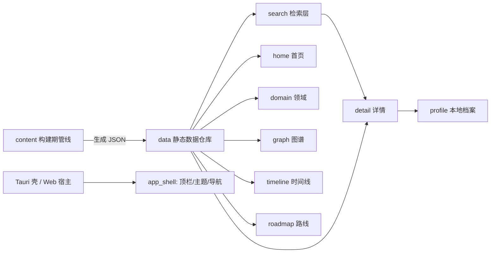

# 架构设计文档：AiIsAllYouNeed（AI 知识星图）

- **输入与产出基线**：阶段 0 冻结基线（/DESIGN.md v7、overview_prd v2.1.0、FEAT-001..011）+ 阶段 1 选型基线（tech_select_overview.md、ADR-001/002，已确认）
- **ARCH 验收记录**：`_06_dev_process/_01_plan_log/rebuild_v2_plan.md`（S2）；`_06_dev_process/_03_qa_log/rebuild_v2_qa_log.md`（Q19）
- **验收状态**：SUBMITTED（待开发者确认 ARCH-06）

- **产品/域名称**：AiIsAllYouNeed · AI 知识星图
- **产品类型 / 规模**：标准 B2C 产品（读优先知识应用） / 小（单人～3）
- **选定范式**：后端 **B1**（构建期内容管线：事务脚本 + 薄分层；**无运行时后端服务**）+ 前端 **F2**（按业务 Feature 模块）
- **架构模式**：前端 Feature 模块化单体；构建期管线 = 脚本编排
- **指导详规**：`frontend_arch.md`（F2）；`dev_paradigm.md` §3/§4
- **更新日期**：2026-10-17

---

## [VIBE_CONTRACT] 架构执行契约 (Machine-Actionable Architecture)

```yaml
architecture_contract:
  domain_name: "AiIsAllYouNeed"
  paradigm:
    backend_tier: "B1（构建期内容管线：脚本+薄分层，无运行时服务）"
    frontend_tier: "F2（按业务 Feature 模块）"
  module_path_map:
    frontend:
      feature_modules: "src/features/{home,domain,graph,timeline,roadmap,search,detail,profile}"
      data_layer: "src/data"
      search: "src/search"
      app_shell: "src/app"
      shared_ui: "src/components"     # 自绘图标族 / DESIGN tokens / 玻璃透镜控件
      styles: "src/styles"            # tokens.css [data-theme] / DESIGN.md 映射
    content_pipeline:
      scripts: "scripts/content/*"
      schemas: "scripts/content/schema.ts"      # zod 校验
      knowledge_sources: "scripts/content/sources/*"  # 可插拔 KnowledgeSource
      generated: "public/data/*.json"           # 构建产物（打包进应用）

dependency_rules:
  - "RULE: 依赖方向只向内 —— feature 可依赖 data/search/shared；data 不依赖 feature；禁止循环依赖"
  - "RULE: 全局能力（搜索/主题/导航）只存在于对应 feature 或 app_shell，禁止多份控件"
  - "RULE: 运行时代码零网络请求、零服务器依赖（内容全部构建期生成）"
  - "RULE: 领域色/强调色/玻璃控件只允许经 shared_ui 与 styles tokens 落地，禁止组件内硬编码色值"
```

---

## 0. 范式选型与权衡 (Human Rationale)

| 项 | 值 |
|----|-----|
| 复杂度信号 | 8 能力、4 视图互达且数据一致；本地档案状态；构建期内容生成 + 可插拔内容源；检索性能硬指标 |
| 后端阶 | **B1** — 构建期内容管线（脚本 + 薄分层）。运行时无服务，全部逻辑在客户端 |
| 前端阶 | **F2** — 按业务 Feature 模块 |
| 为何不升级 | 无运行时后端 → 不需要 B2+ 用例服务层；单前端无多后端上下文 → 不需要 F3/FSD |
| 为何不降级 | 8 个业务 Feature + 数据层/检索层分工明确，F0/F1 单目录会让 `src/` 膨胀到难以维护 |

---

## 1. 边界设计（非 DDD · 业务模块图）



| 模块 | 职责 | 依赖 | 数据归属 |
|------|------|------|----------|
| `content`（构建期） | 标题清单 → 检索/理解生成 → 契约校验 → 产出 JSON + 倒排索引；可插拔 KnowledgeSource | 无（Node 脚本） | 写入 `public/data/*.json` |
| `data` | 知识 JSON 的加载、类型化访问、领域元数据；WikiLink/反向链接解析 | content 产物 | 只读知识仓库 |
| `search` | bigram 倒排构建/检索 + 高亮 + ⌘K | data | 只读索引（内存） |
| `home / domain / graph / timeline / roadmap / detail / profile` | 各业务屏（见 §6） | data/search/shared | 只读知识 + 档案（profile 可写） |
| `profile` | 本地档案（昵称/收藏/已读/笔记/主题偏好）持久化 | localStorage / Tauri Store | 本机档案（可写，唯一写方） |
| `app_shell` | 顶栏（灯罩）、主题唯一入口、全局导航、底部 Tab | shared | — |
| 分发 | Tauri 2 壳（六端）或静态 Web 宿主 | app | — |

---

## 2. 统一语言（摘录）

| 术语 | 定义 | 禁止别名 | 所在模块 |
|------|------|----------|---------|
| 知识点 (point) | 知识图谱的原子节点：标题/别名/领域/年份/重要性/难度/学习时长/标签/媒体/正文/论文/依赖/相关/反向链接 | 词条、卡片 | data/所有视图 |
| 领域 (domain) | 知识点的分类集合（= 星座），≤6 起可扩展 | 分类、标签组 | data/home/domain |
| 依赖/相关 (deps/related) | 前置·衍生（实线）与相关（虚线）关系 | 关联、链接 | graph/detail |
| 反向链接 (backlinks) | 引用本知识点的其他知识点（构建期由内容管线解析） | 引用列表 | detail |
| 路线 (roadmap) | 领域内「基础→进阶→前沿」分阶段路径 | 学习路径、计划 | roadmap |
| 档案 (profile) | 本机唯一可写数据：昵称/头像色/收藏/已读/笔记/主题偏好 | 账户、用户 | profile |

完整词典：`_00_project_foundation/_02_dictionary/_02_project_word.dict.yaml`。

## 3. 分层与职责（前端 F2）

```text
app_shell：顶栏/主题/导航/路由出口
├─ features/*：home domain graph timeline roadmap search detail profile（每 Feature 自含 组件+视图+局部状态）
├─ data：知识加载、类型、领域元数据、WikiLink/反向链接解析
├─ search：bigram 索引 + 检索 + 高亮
├─ components：自绘图标族 / 玻璃控件（灯罩/透镜/展柜）/ 纸面行 / 分段控件
└─ styles：tokens.css（[data-theme=day|night]、三用途玻璃、DESIGN.md 全映射）
```

- 依赖**只向内**：feature → data/search/components/styles；data 与 search 之间单向（search 读 data）；**feature 之间不直接互引**（跨屏跳转经路由 + 全局导航）。
- `profile` 是唯一写方（档案持久化）；其余模块对知识数据只读。
- 全局能力唯一性：主题控件只在 `app_shell`；搜索入口只在 `app_shell`（⌘K 与顶栏触发同一搜索 feature 的浮层）；领域趋势只在 `roadmap`（其余页面只给入口）。

## 4. 核心实体与不变量（简表，非 DDL）

| 实体 | 关键字段（阶段 3 定全） | 不变量 |
|------|------------------------|--------|
| `KnowledgePoint` | id、title、aliases、domain、year、importance、difficulty、learnTime、tags、media、summary、body、papers、deps、related、backlinks | id 唯一；aliases 唯一可跳转；deps/related 指向存在的 id；backlinks 由管线按引用自动推导（不手填） |
| `Domain` | key、name、color、order | 色板 ≤6 起可扩展；order 决定首页星座位置 |
| `Roadmap` | domainKey、stages[]（基础/进阶/前沿）、stageOf(point) | 每 point 至多属一个阶段；无分段时降级「全部」 |
| `Profile`（本机） | nickname、avatarColor、favorites、readStates、notes、themeMode | 仅本机；无账号无上传 |

## 5. 关键用例 → 六元组（method / compensate / fallback）

| 用例 | 模块 | method | compensate | fallback |
|------|------|--------|------------|----------|
| 打开详情并顺链 | detail | 路由参数 → data 取 point → 解析 wikiLink/backlinks | — | 缺字段降级（不显示空区块） |
| ⌘K 搜索 | search | bigram 检索 → 高亮 → 结果列表 | 清空/关闭浮层 | 无结果空态 + 推荐词 |
| 图谱聚焦节点 | graph | 点节点 → 透镜聚焦 + 详情栏联动 | 关闭详情栏/重置筛选 | 空画布引导 + 重置 |
| 收藏/已读/笔记 | profile | 写档案 store → 状态回流 UI | 撤销/取消 | 首次建档轻量浮层（可跳过） |
| 主题切换 | app_shell | 唯一控件 → 写 themeMode → 应用 `[data-theme]` | — | 跟随系统（prefers-color-scheme） |
| 构建期内容生成 | content | 标题清单 → KnowledgeSource 生成 → zod 校验 → 写 JSON + 索引 | 校验失败阻断构建 | 可插拔源；契约校验 + 人工抽查 |

## 6. 前端架构对齐（F2 映射）

| 业务模块 | feature / 路由 | 页面 | 状态来源 |
|----------|----------------|------|----------|
| browse | home `/` · domain `/domain/:key` | 首页全景 / 领域页 | data（只读） |
| navigate | graph `/graph` · timeline `/timeline` · roadmap `/roadmap` | 图谱/时间线/路线 | data（只读） |
| retrieve | search（app_shell 浮层） | ⌘K 搜索 | search 索引（内存） |
| read | detail `/point/:id` | 知识点详情 | data（只读） |
| personal | profile（app_shell 抽屉或 `/profile`） | 本地档案 | profile store（本机可写） |
| distribution | Tauri 壳 / Web 静态宿主 | 六端壳 | — |

## 7. 决策与禁忌

- **Do**：依赖只向内；全局能力单点实现；运行时代码零网络；知识数据只读、档案唯一写方；所有颜色/玻璃经 tokens 与 shared 组件落地；图谱自绘 SVG（星图册）。
- **Don't**：feature 互相直连共享状态；在组件里硬编码色值；引入运行时后端/网络请求；用第三方图标库/重可视化库；同一信息多页重复主呈现。
- 相关 ADR：`_00_project_foundation/_03_decision_record/ADR_001_tauri2_shell.md`、`ADR_002_react_vite_spa.md`。

## 8. ARCH 验收清单（待开发者确认）

| ID | 待确认项 | 证据 |
|----|----------|------|
| ARCH-01 | 边界：8 feature + data/search/profile 唯一写方 + 构建期管线，无运行时服务 | §1 |
| ARCH-02 | 职责与数据所有权：知识只读、档案唯一写、全局能力单点 | §1/§3 |
| ARCH-03 | 关键运行场景映射（阅读/搜索/图谱/档案/主题/构建） | §5 六元组 |
| ARCH-04 | 部署：静态 dist + Tauri 壳六端；本机无 Rust 工具链（打包期） | §1 分发、tech_select §4 |
| ARCH-05 | 质量/安全：离线零网络、localStorage/Tauri Store 档案、CSP、日/夜 WCAG AA | §3/§4 |
| ARCH-06 | 权衡与风险：F2/B1 够用、图谱 LOD 预案、内容质量契约 | §0/tech_select §5 |

> **选型结论**：`[ ] APPROVED（进入阶段 3 详细设计）` / `[ ] REJECTED`
> **开发者确认**：__________ **日期**：__________

