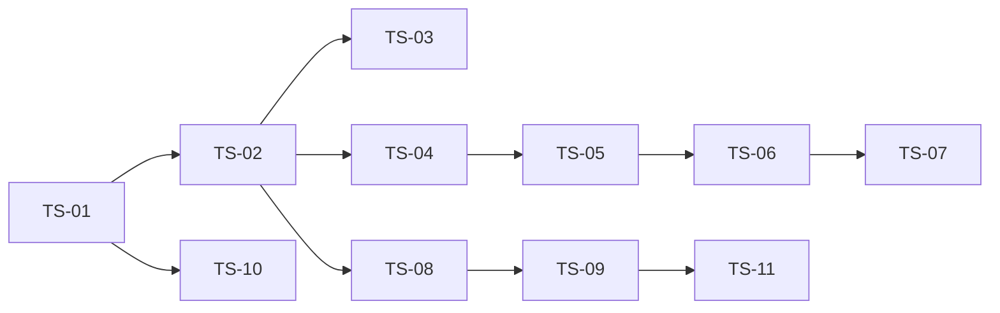

# 任务拆解与上下文装配：阶段 4（TASK-01..05）

- **输入基线**：阶段 0–3 全部已确认基线（/DESIGN.md v7、overview_prd v2.1.0、FEAT-001..011、tech_select、arch_design、data_schema、module_contracts、mapping_matrix）
- **验收状态**：SUBMITTED（待开发者确认切片顺序与交付边界 TASK-05）

> 切分策略（对齐分阶段规划「垂直曳光弹」）：**先贯通最窄端到端通路（内容→数据→列表→详情）**，再横向铺满各视图。

## 1. 切片清单（TASK-01/02：需求全覆盖 + 可验证切片）

| 切片 | 目标（垂直/能力） | 边界 | 输入 | 输出/DoD | 测试 seam |
|------|--------------------|------|------|----------|-----------|
| **TS-01 地基** | 脚手架 + DESIGN tokens + 全局壳 | Vite+React+TS 工程、tokens.css、路由、顶栏(灯罩)/主题唯一控件/底部Tab、图标族骨架 | DESIGN.md v7、FEAT-009、ADR-002 | `pnpm dev/build` 通过；日/夜切换无闪烁；主题控件唯一 | 主题切换单测；build 产出 |
| **TS-02 曳光弹（内容→列表→详情）** | 最窄端到端：标题清单→生成→校验→JSON→首页列表→详情 | content 管线(static fixture 源) + data 加载 + home 列表 + detail 基础 | FEAT-010/001/007、data_schema、module_contracts | 构建产出合法数据；首页列表可点进详情；zod 违规阻断构建 | 管线校验失败样例；数据加载双校验 |
| **TS-03 检索** | bigram 索引 + ⌘K 浮层 + 高亮 | search feature + app_shell 入口 | FEAT-006、实测基准 | <100ms；命中高亮；空态推荐词；Esc/⌘K | 检索命中/未命中单测 |
| **TS-04 图谱** | 星图册 SVG + d3-force 布局 + 透镜聚焦 + 详情栏 | graph feature + rail | FEAT-003、DESIGN.md §7 | 曲线边/星点/透镜/图例/空态重置；移动端底部抽屉 | 聚焦/筛选状态单测 |
| **TS-05 时间线** | 纵向时间线 + 时代分段 + 领域筛选 | timeline feature | FEAT-004 | 年份排序、分段锚点、筛选 | 排序/筛选单测 |
| **TS-06 路线** | 领域路线 + 趋势主呈现 | roadmap feature | FEAT-005 | 三阶段泳道；趋势唯一主呈现；领域页只给入口 | 阶段映射单测 |
| **TS-07 领域页** | 领域聚合 + 三视图入口 | domain feature | FEAT-002 | 规模/关键点/入口；趋势仅入口 | 聚合单测 |
| **TS-08 档案** | 建档浮层 + 收藏/已读/笔记 + 持久化 + 主题联动 | profile feature + ProfileStore | FEAT-008/009 | 即用即建；状态回流；写失败回退内存；数据不出本机 | 档案 CRUD 单测（内存适配器） |
| **TS-09 详情增强** | media/KaTeX 公式/papers/backlinks + 全字段可链接 | detail feature 完备 | FEAT-007、D3/D5 | 正文块渲染、wiki 跳转、反向链接、缺字段降级 | 块渲染/链接解析单测 |
| **TS-10 六端壳** | Tauri 2 壳 + 打包 + 分发 | Tauri 配置 + CI | FEAT-011、ADR-001 | Web 构建必达；桌面产物（工具链齐时）；壳内运行一致 | 壳内冒烟 |
| **TS-11 阶段6 验证** | 需求验证矩阵 + 全量演练 | 全站 | 全部基线 | 必需 REQ 全部映射断言；报告 + 偏差表 | 端到端演练 |

## 2. 依赖与风险（TASK-03）

| 依赖 | 说明 | 风险/时点 |
|------|------|-----------|
| TS-01 是全部前置 | 壳与 tokens 先立 | 低 |
| TS-02 先于 04–09 | 数据与详情通路先行，防止视图无数据可验 | 内容质量风险（阶段5） |
| TS-10 可并行 | 壳配置不依赖 feature | 本机无 Rust 工具链 → 桌面/移动产物延后（登记环境约束） |
| 先解决未知项 | 检索性能、图谱布局在各自切片首日验证 | 高 → 已实测检索；图谱 LOD 预案 |

## 3. Context Pack（TASK-04 摘要）

每个切片装载的「来源路径 + 版本 + 规则 ID」：

| 切片 | 绑定来源 |
|------|----------|
| TS-01 | `/DESIGN.md`(v7)、FEAT-009 PRD/Vibe、ADR-002、arch §3/§6 |
| TS-02 | FEAT-010/001/007 PRD+Vibe、`data_schema.md`、`module_contracts.md` §1.1/§1.4 |
| TS-03 | FEAT-006 PRD+Vibe、`module_contracts.md` §1.2、tech_select §6（实测基准） |
| TS-04 | FEAT-003 PRD+Vibe、DESIGN.md §7（星图册/透镜） |
| TS-05 | FEAT-004 PRD+Vibe |
| TS-06 | FEAT-005 PRD+Vibe、overview_prd §6（趋势唯一） |
| TS-07 | FEAT-002 PRD+Vibe、overview_prd §6 |
| TS-08 | FEAT-008 PRD+Vibe、`module_contracts.md` §1.3 |
| TS-09 | FEAT-007 PRD+Vibe、`data_schema.md` §2（body/backlinks） |
| TS-10 | FEAT-011 PRD+Vibe、ADR-001、tech_select §4 |
| TS-11 | 全部已确认基线 + `mapping_matrix.md` |

## 4. 验收执行计划（TASK-05）

- 每切片 DoD = 上表「输出/DoD」+ 测试 seam；切片完成即提交证据（IMPL-06），可按逻辑批次合并验收。
- 阶段 5 内演练点：TS-02 曳光弹端到端、TS-04 图谱交互、TS-08 档案持久。
- 阶段 6 需求验证矩阵分母 = 冻结基线 REQ（11 FEAT 全量）。

> **结论**：`[ ] APPROVED（进入阶段 5 实现切片）` / `[ ] REJECTED`
> **开发者确认**：__________ **日期**：__________
